# Event Horizon

**A real-time general-relativistic black hole, ray traced in the browser.**

### ▶ [Launch the simulation](https://selim7417.github.io/event-horizon/) · [Start the guided tour](https://selim7417.github.io/event-horizon/#tour)

Every pixel follows a ray of light backwards through the curved spacetime of a Schwarzschild black hole, until it lands on the glowing accretion disk, escapes to the stars, or crosses the event horizon. The colours come from physics: blackbody radiation, Doppler beaming and gravitational redshift, all computed per pixel, every frame.

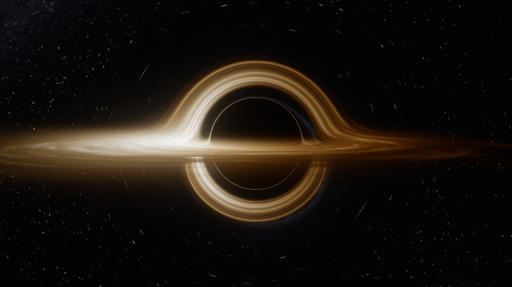

WebGL2 and hand-written GLSL. No engine, no libraries, no build step required.

---

## What you can do

- **Take the guided tour.** Eight short chapters, about three minutes, from the shadow to falling through the horizon.
- **Fly around freely.** Drag to orbit, scroll to fall closer, right-drag to look away from the hole.
- **Choose how you move.** Hover on rockets, coast in orbit, or fall freely. Each one sees a different sky, because aberration and Doppler shift depend on your velocity.
- **Switch gravity off.** Slide spacetime curvature from 100% to 0% and watch the lensed image collapse into what is physically there: a sphere and a flat ring.
- **See it as a radio telescope would.** The EHT view blurs the image to the resolution of an Earth-sized telescope and recreates the famous M87\* photograph.
- **Read the instruments.** Live distance, time dilation, shadow size, hover thrust and tidal stretch for real black holes, from Cygnus X-1 to TON 618, plus two clocks that drift apart as you sink.
- **Watch the light paths.** A side-view diagram re-integrates the same equations on the CPU and shows which rays hit the disk, escape or fall in.

<table>
  <tr>
    <td width="50%">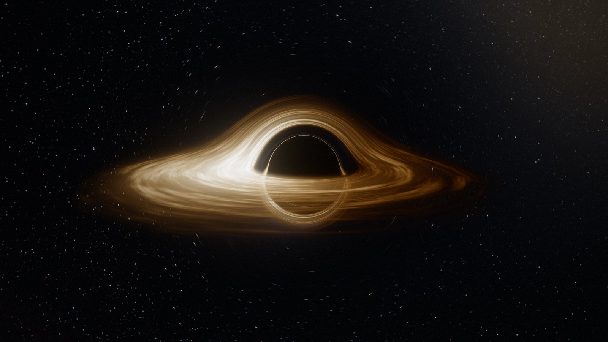</td>
    <td width="50%">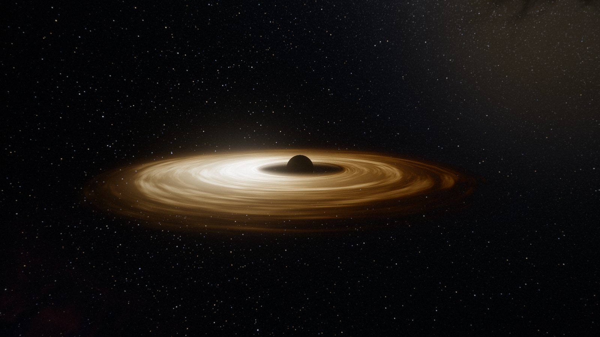</td>
  </tr>
  <tr>
    <td><sub><b>Gravity on.</b> The arch over the shadow is the far side of the disk, its light bent over the hole.</sub></td>
    <td><sub><b>Gravity off.</b> The same scene with curvature set to zero: just a sphere and a flat ring.</sub></td>
  </tr>
  <tr>
    <td>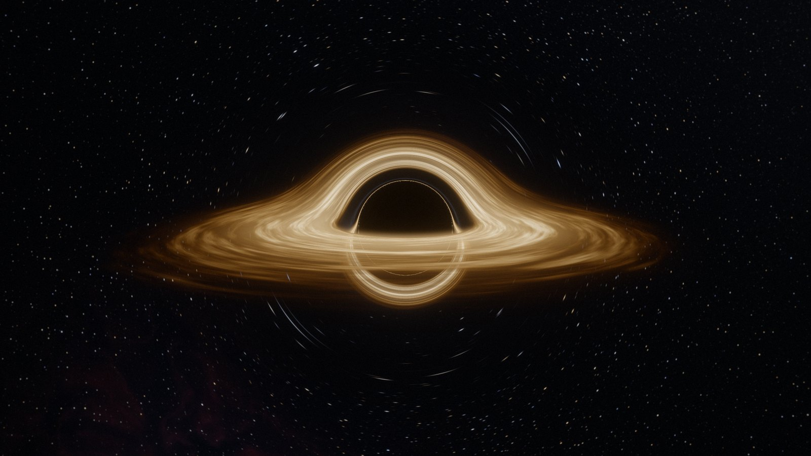</td>
    <td>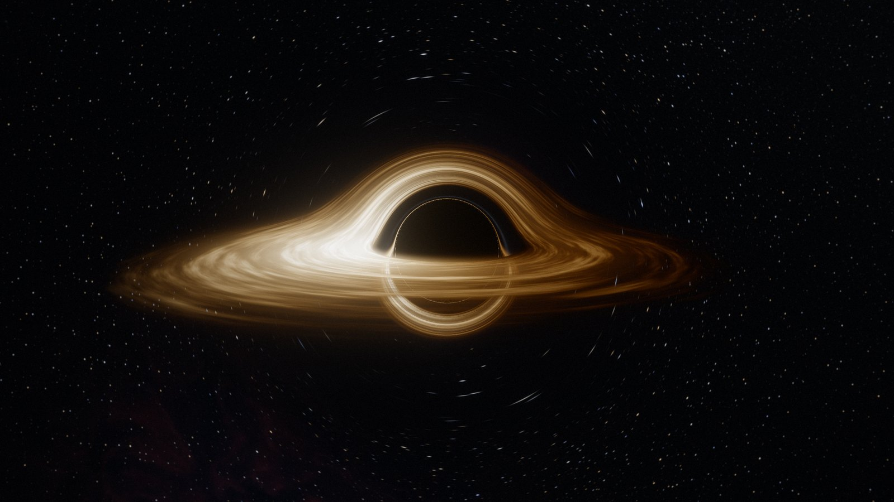</td>
  </tr>
  <tr>
    <td><sub><b>No Doppler shift</b>, as in the film <i>Interstellar</i>.</sub></td>
    <td><sub><b>With Doppler beaming.</b> Gas orbiting toward you at up to half the speed of light shines brighter and bluer.</sub></td>
  </tr>
  <tr>
    <td>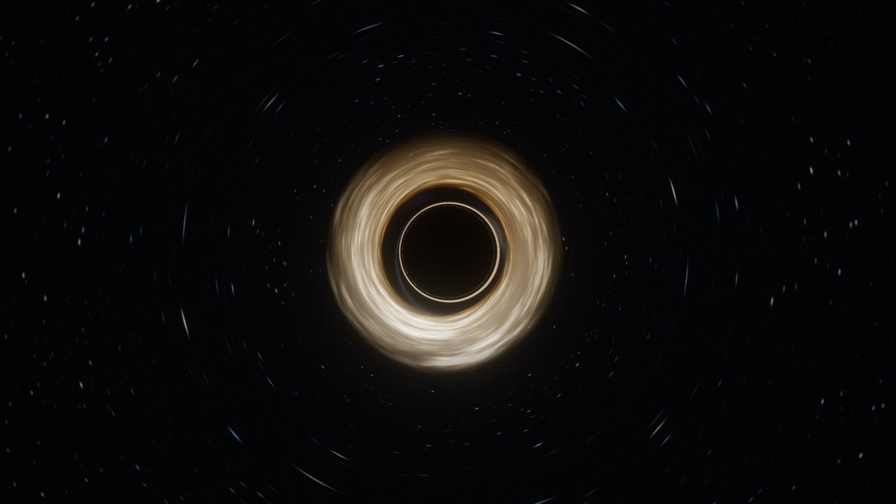</td>
    <td>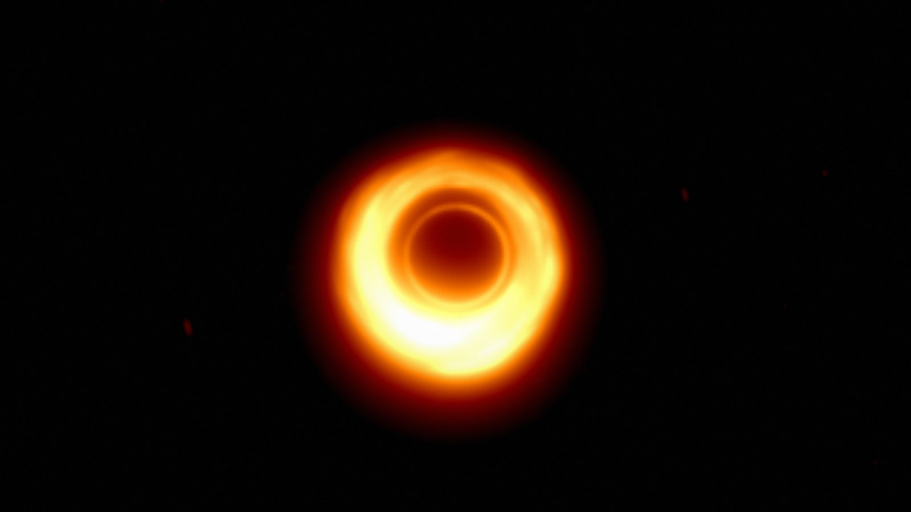</td>
  </tr>
  <tr>
    <td><sub><b>M87\* at 17°</b>, the viewing angle of the 2019 Event Horizon Telescope image.</sub></td>
    <td><sub><b>The same view at EHT resolution</b>: a lopsided ring around a dark centre.</sub></td>
  </tr>
  <tr>
    <td>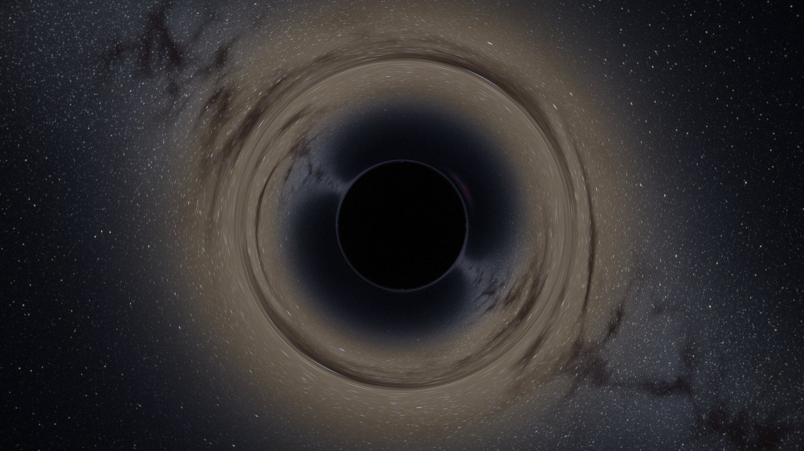</td>
    <td>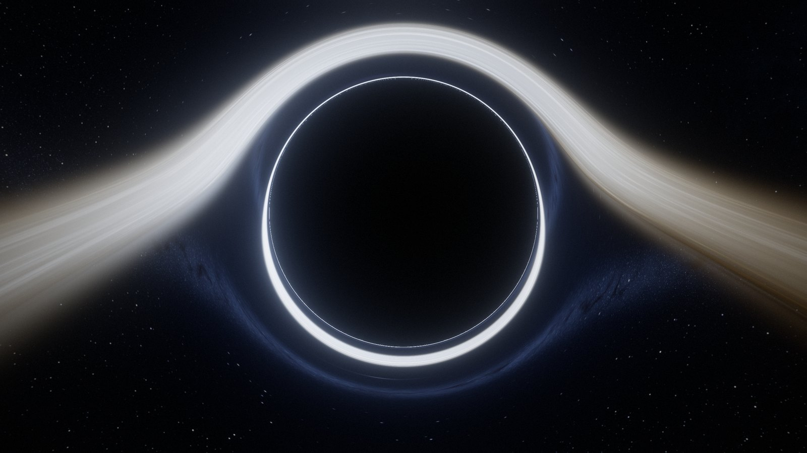</td>
  </tr>
  <tr>
    <td><sub><b>Einstein ring.</b> With the disk removed, the bulge of the galaxy behind is bent into a ring.</sub></td>
    <td><sub><b>Falling in</b> at 1.35 r<sub>s</sub>. The disk is blueshifted and the photon ring hugs the shadow.</sub></td>
  </tr>
  <tr>
    <td>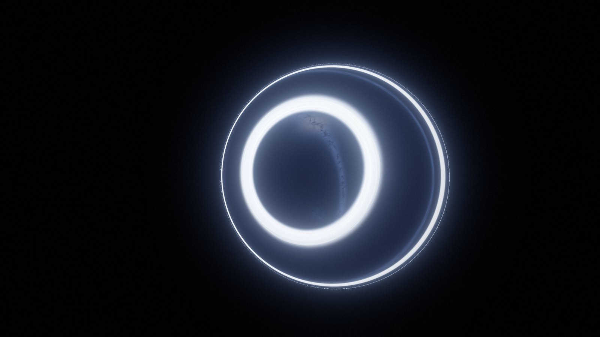</td>
    <td align="center">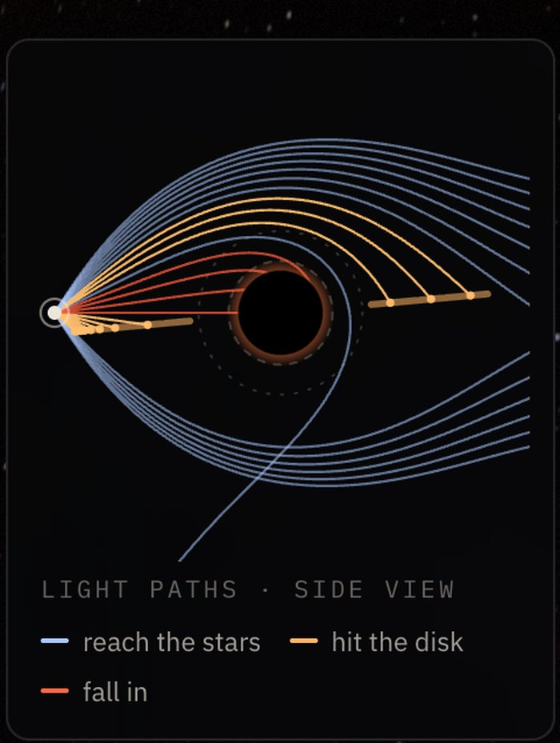</td>
  </tr>
  <tr>
    <td><sub><b>Hovering</b> 6% of a radius above the horizon and looking out. The whole universe arrives through one blueshifted window.</sub></td>
    <td><sub><b>Light paths</b>, re-integrated on the CPU. Rays passing over the hole land on the far side of the disk, which is why it appears as an arch.</sub></td>
  </tr>
</table>

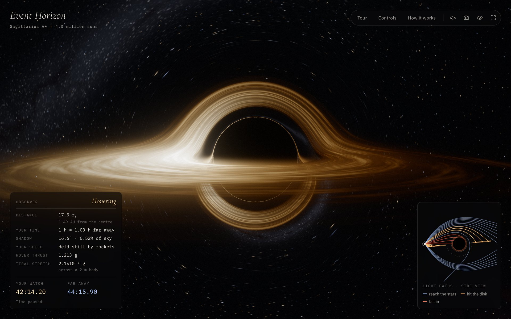

<p align="center">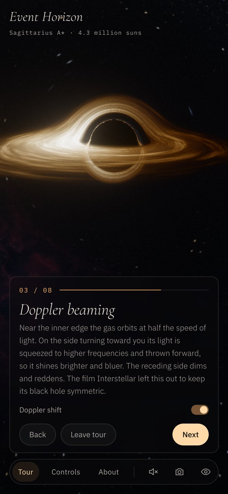</p>

---

## The physics

Units: the Schwarzschild radius is 1 ($r_s = 2GM/c^2 = 1$, so $M = 1/2$ with $G = c = 1$).

### Light rays

In Schwarzschild coordinates, with $u = 1/r$, a photon's orbit obeys the Binet equation

$$\frac{d^2u}{d\varphi^2} + u = \frac{3}{2}\, r_s\, u^2 .$$

That is exactly the orbit of a Newtonian particle under the fictitious force

$$\mathbf{a} = -\frac{3}{2}\,h^2\,\frac{\mathbf{x}}{r^5}, \qquad h = |\mathbf{x}\times\mathbf{v}| = \text{const},$$

so a ray can be integrated in ordinary Cartesian coordinates. The fragment shader uses velocity Verlet with an error-bounded adaptive step, up to 480 steps per pixel.

The camera's directions are defined in the local frame of the observer. A static observer at radius $r$ sees a ray at angle $\alpha$ from the outward radial direction with impact parameter $b = r\sin\alpha/\sqrt{1 - r_s/r}$, which the tracer reproduces by shrinking the radial component of each camera ray by the lapse $\sqrt{1-r_s/r}$.

`npm run check` bisects for the edge of the shadow at several camera distances and compares it with the analytic critical impact parameter $b_c = \tfrac{3\sqrt3}{2} r_s$:

| Preset | Error at r = 3, 6, 26, 100 r<sub>s</sub> |
|---|---|
| Low | −0.34% |
| Medium | −0.21% |
| High | −0.13% |
| Ultra | −0.07% |

For moving observers, each camera ray is first aberrated from the observer's frame into the static frame:

$$\cos\theta_{\text{static}} = \frac{\cos\theta_{\text{obs}} - \beta}{1 - \beta\cos\theta_{\text{obs}}} .$$

| Observer | Speed (vs. static) | $dt/d\tau$ |
|---|---|---|
| Hovering | $0$ | $1/\sqrt{1 - r_s/r}$ |
| Circular orbit | $\sqrt{r_s / 2(r - r_s)}$ | $1/\sqrt{1 - 3r_s/2r}$ |
| Falling from rest at infinity | $\sqrt{r_s/r}$ | $1/(1 - r_s/r)$ |

### The disk

A geometrically thin disk from the innermost stable circular orbit ($3r_s$) outwards, with the Novikov–Thorne / Shakura–Sunyaev temperature profile for zero torque at the inner edge:

$$T(r) \propto r^{-3/4}\left(1 - \sqrt{r_{\text{in}}/r}\right)^{1/4}.$$

Its turbulence is advected by Keplerian differential rotation, $\Omega = \sqrt{GM/r^3}$, with two cross-faded copies so the shear never winds up. Optical depth grows with the slant path through the disk, and a Gaussian corona above and below is integrated analytically along each step with $\operatorname{erf}$, so coarse steps never band.

### Colour

Colours are not chosen; they are computed. A lookup table integrates Planck's law against the CIE 1931 colour-matching functions (the multi-lobe fit of Wyman, Sloan and Shirley) and converts to linear sRGB.

Because $I_\nu/\nu^3$ is conserved along a ray, a blackbody at temperature $T$ seen with frequency ratio $g = \nu_{\text{obs}}/\nu_{\text{emit}}$ is exactly a blackbody at $g\,T$. For gas on circular orbits:

$$g = \underbrace{\sqrt{1 - r_s/r}}_{\text{gravity}} \cdot \underbrace{\frac{\sqrt{1 - v^2}}{1 - \Omega\, b_z}}_{\text{motion}} \cdot \underbrace{g_{\text{camera}}}_{\text{observer}}$$

where $b_z$ is the photon's angular momentum about the disk axis per unit energy, which is constant along the ray. Doppler beaming, colour shift and gravitational redshift therefore cost one texture lookup, and the same shift is applied to every star.

### Scale invariance

The image is identical for every mass; only lengths and times scale with $r_s$. The instruments use real masses (Cygnus X-1, Sagittarius A\*, M87\*, TON 618) to turn the picture into kilometres, minutes and g-forces.

---

## Rendering pipeline

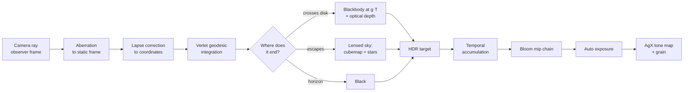

- **Procedural universe.** A Milky Way with a bulge and dust lanes, two nebulae and a distant spiral galaxy are baked once into an HDR cubemap. Stars are drawn analytically on a cube-sphere grid. Each star is widened and dimmed by the pixel's lensing footprint (`fwidth` of the final ray direction), so demagnified stars near the shadow don't sparkle.
- **Temporal anti-aliasing.** Rays are jittered along a Halton sequence and blended with the previous frames. The blend weight comes from how far the view moved, measured in pixels, so a still or slowly drifting view converges to a supersampled image while fast moves stay sharp.
- **Photo mode.** *Save image* re-traces the frozen scene at full resolution with the Ultra preset and averages 12 jittered frames, giving a 5–6 megapixel PNG in about two seconds on a laptop.
- **HDR post-processing.** A 13-tap downsample with Karis averaging, tent-filtered upsampling, centre-weighted auto exposure that adapts over about 0.7 s, AgX tone mapping and film grain.
- **Adaptive step size.** Each step is bounded by the integrator's local error (which grows with the rate of change of the force, $4k/r^5$) rather than by a fixed fraction of $r$. Rays grazing the photon sphere keep fine steps; the many rays passing far from it take long ones. That is about 40% fewer steps at the same accuracy.
- **Dynamic resolution from real GPU time.** GPU timer queries measure each frame, or, where they are unavailable, fences reveal frames piling up in the GPU queue. The traced pixel count is sized to three quarters of the frame interval the browser actually grants: 60 fps normally, 30 fps when Low Power Mode caps animation. Timing in JavaScript alone is not enough, since a browser can keep firing animation frames while the GPU falls behind.
- **Lens shift.** An off-centre projection lifts the subject above the tour captions without tilting the camera.
- **Sound.** A Web Audio drone whose pitch follows the blueshift at the observer's position.

## Running it

Any static file server works, since ES modules need HTTP:

```bash
python3 -m http.server 8000
```

Then open http://localhost:8000. Add `#tour` to the address to start the tour directly, or `#explore` to skip straight to free flight.

To make a single self-contained file that opens with a double-click:

```bash
python3 tools/build.py
```

This writes `dist/event-horizon.html`, about 140 KB with everything inlined. The bundler is a short Python script that wraps each ES module in a function scope, so there is nothing to install.

### Deploying to GitHub Pages

1. Push this folder to a new GitHub repository.
2. In **Settings → Pages**, choose **Deploy from a branch**, then select `main` and `/ (root)`.
3. The site appears at `https://<your-user>.github.io/<repo>/`. If you fork it, point the `og:image` and `og:url` addresses in `index.html` at your own copy so link previews work.

## Controls

| Input | Action |
|---|---|
| Drag | Orbit the black hole |
| Scroll · pinch · W / S | Move closer or further |
| Right-drag · Shift-drag | Look around |
| Space | Pause time |
| ← → | Previous or next tour chapter |
| T · C · H | Tour · controls · hide interface |
| P · F · M | Save image · full screen · sound |

## Project structure

```
index.html            page and copy
css/style.css         interface (single dark look, responsive down to phones)
js/main.js            app loop, input, observers, instruments
js/renderer.js        passes, sky baking, bloom, auto exposure, dynamic resolution
js/shaders/trace.js   the geodesic ray tracer (disk, corona, stars, sky)
js/shaders/sky.js     procedural Milky Way, nebulae, galaxy (baked once)
js/shaders/post.js    bloom, luminance, AgX composite, EHT view
js/blackbody.js       Planck × CIE 1931 colour table
js/physics.js         Schwarzschild formulas, CPU photon integrator
js/diagram.js         light-path diagram
js/tour.js            the eight chapters
js/camera.js          orbit camera with free look, roll and inertia
js/audio.js           generative drone
js/gl.js              small WebGL2 helper
tools/build.py        single-file bundler
tools/check-geodesics.mjs   accuracy check against the analytic shadow
```

## Limitations and next steps

- The black hole does not spin. A Kerr metric would add frame dragging and an asymmetric shadow.
- The disk is geometrically thin, and its turbulence is a texture rather than a fluid simulation.
- Light travel time across the scene is ignored; the disk is drawn at a single coordinate time.
- History is discarded during fast camera moves. Reprojection along the lensed rays would keep the anti-aliasing during motion too.

## References

- J.-P. Luminet, *Image of a spherical black hole with thin accretion disk*, A&A 75 (1979). The first simulated image of a black hole.
- O. James, E. von Tunzelmann, P. Franklin, K. S. Thorne, *Gravitational lensing by spinning black holes in astrophysics, and in the movie Interstellar*, CQG 32 (2015).
- Event Horizon Telescope Collaboration, *First M87 Event Horizon Telescope Results I*, ApJL 875 (2019).
- I. D. Novikov & K. S. Thorne, *Astrophysics of black holes* (1973); N. I. Shakura & R. A. Sunyaev, A&A 24 (1973).
- C. Wyman, P.-P. Sloan, P. Shirley, *Simple analytic approximations to the CIE XYZ color matching functions*, JCGT 2 (2013).
- R. Antonelli, *Starless*: the Binet-equation trick for ray tracing Schwarzschild geodesics.
- T. Sobotka, AgX tone mapping; polynomial fit by B. Wrensch.

## License

MIT. See [LICENSE](LICENSE).
